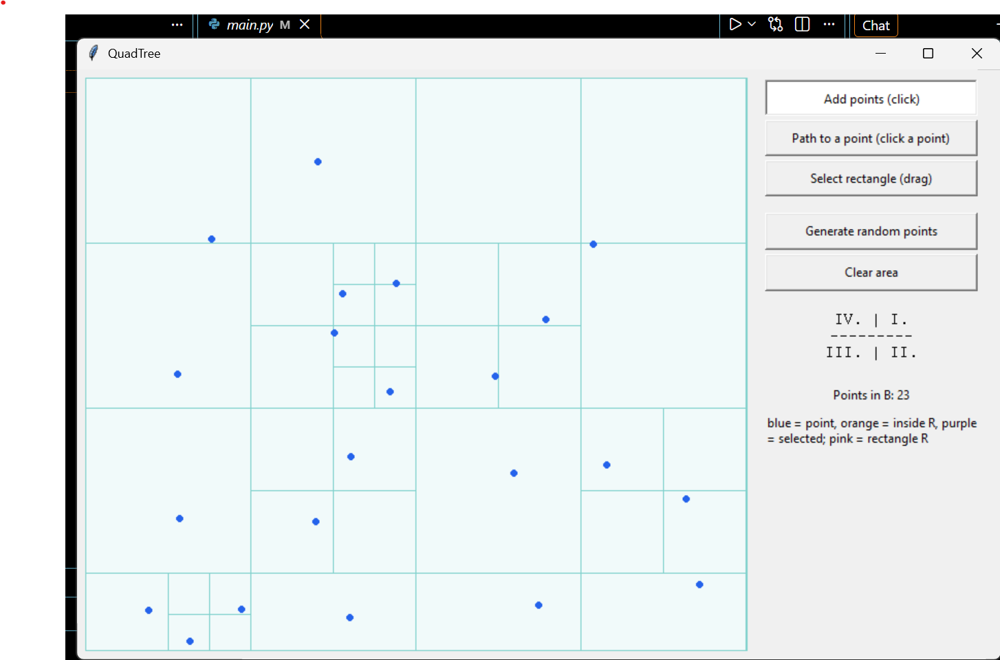

COMPUTER GRAPHICS (1) - PROGRAMMING ASSIGNMENT NO. 1 Topic: QuadTree

README - USER INSTRUCTIONS
## Application Screenshot

1.  RUNNING THE APPLICATION Make sure Python 3 is installed. Tkinter is
    used for the graphical interface and is normally included with
    Python.

    Open a terminal in the folder containing main_colored.py and run:

        python main_colored.py

    No external Python packages are required.

2.  DRAWING AREA The large square on the left is the drawing area.
    Points are added and selected directly with the mouse. The QuadTree
    subdivision is displayed automatically when points are added.

3.  CONTROL MODES

    Add points (click) Select this mode and click inside the square to
    add a point. Added points remain visible while the application is
    running.

    Path to a point (click a point) Select this mode and click close to
    an existing point. The application highlights the QuadTree squares
    from the root to the leaf containing that point. The path is also
    written in the information area. Click close to the centre of a
    point; the application searches within a distance of 12 pixels.

    Select rectangle (drag) Select this mode, hold the left mouse
    button, and drag across the drawing area to create an axis-aligned
    rectangle R. Points inside R are highlighted while dragging. The
    information area shows how many points are inside the rectangle.

4.  BUTTONS

    Generate random points Adds 50 points at random positions in the
    drawing area.

    Clear area Removes all points and resets the QuadTree and the
    current selection.

5.  COLORS

    Blue - normal points Orange - points inside rectangle R Purple -
    selected point and outline of the path squares Pink - selection
    rectangle R Light purple - shaded QuadTree squares along the
    selected path Light cyan - drawing background and QuadTree grid
    lines

6.  QUADRANT NAMES

    The four child regions are named as follows:

                   IV | I
                  --------
                  III | II

    I is the upper-right region. II is the lower-right region. III is
    the lower-left region. IV is the upper-left region.

7.  INFORMATION AREA

    The text below the controls displays short instructions and
    operation results, such as the number of points, the selected path,
    or the number of points inside rectangle R.

This README describes the controls and the non-obvious interactions
provided by the application.
